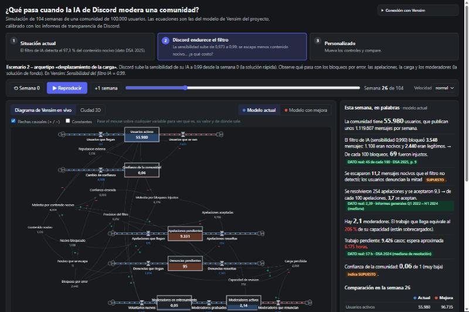
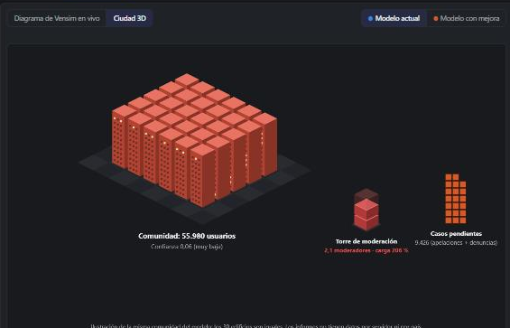

# Simulación web – Moderación con IA en Discord (fase 3)

Página que **ejecuta los modelos oficiales de Vensim** (`../Modelos Vensim/*.mdl`) con **PySD** y muestra los resultados de forma que cualquier persona los entienda.



## Instalación (una sola vez)

Se necesita Python 3.11 o más reciente.

```bash
pip install -r requirements.txt
```

## Ejecución

Desde esta carpeta (`simulacion/`):

```bash
uvicorn app:app --port 8000
```

Luego abra **http://localhost:8000**. Funciona sin internet.

## Cómo se conecta con Vensim

```
Modelos Vensim/*.mdl  ──►  PySD lo traduce a Python  ──►  FastAPI lo simula  ──►  la página lo muestra
```

| Qué se toma del .mdl | Para qué |
|---|---|
| Ecuaciones y valores | PySD ejecuta el modelo tal cual; no hay ecuaciones copiadas en la página |
| Diagrama (posiciones de niveles, flujos, variables y flechas, con su signo) | La vista «Diagrama de Vensim en vivo» se dibuja con esas mismas posiciones |
| Unidades y comentarios | Las ayudas que aparecen al pasar el mouse (incluida la marca DATO, SUPUESTO o CALIBRADO) |
| Valores por defecto | Los controles del escenario personalizado |

- **Si cambian un valor o una ecuación en Vensim y guardan,** el servidor lo detecta por la fecha del archivo y vuelve a traducir el `.mdl` en el siguiente pedido. En la página basta con pulsar «Volver a leer los .mdl» (en «Conexión con Vensim») o elegir otra vez un escenario. Se verificó tocando el `.mdl`: el servidor lo retradujo sin reiniciarse.
- **Si renombran una variable,** la página no la encuentra. Usa por nombre, por ejemplo, *Usuarios activos* y *Moderadores activos*.
- **Si agregan una variable,** se simula y aparece en el diagrama con su ayuda. Las frases y los gráficos de abajo solo muestran las variables que ya conocen.
- **No vuelvan a ejecutar `datos/scripts/06_modelos_vensim.py`** si editaron el `.mdl` en Vensim: ese script regenera los `.mdl` y borra los cambios.

## Qué tiene la página

1. **Tres escenarios con un clic:**
   - *Situación actual*.
   - *Discord endurece el filtro*: sensibilidad 0,99, que muestra el arquetipo de desplazamiento de la carga.
   - *Personalizado*: 5 controles que se aplican por igual a los dos modelos.

   Todos se simulan desde la semana 0, así que se pueden reproducir exactamente en Vensim cambiando la constante indicada.
2. **Diagrama de Vensim en vivo:**
   - Los niveles son cajas que se llenan.
   - Las tuberías tienen puntos que se mueven según el flujo.
   - Las flechas causales son curvas y llevan su signo + o −.
   - Al pasar el mouse por una variable se ven su valor, unidad, ecuación y comentario.
3. **Comparación del modelo actual con el modelo con mejora:** seis gráficos con las dos curvas y la semana marcada. Haciendo clic en un gráfico se salta a esa semana.
4. **Esta semana, en palabras:**
   - Frases como «de cada 100 bloqueos, 45 fueron injustos», al lado del **dato real** de los informes de Discord.
   - Una tabla que compara los dos modelos.
5. **Ciudad 3D:** ilustración isométrica de la comunidad, con un aviso en pantalla de que es ilustrativa.
   - Altura de los edificios: usuarios.
   - Color: confianza.
   - Torre de moderación: un piso por moderador, en rojo si hay sobrecarga.
   - Bodega: casos pendientes.



## Qué NO se inventó

- No hay datos por país ni por servidor. Los informes de Discord solo dan totales globales y de la UE.
  - La ciudad reparte la comunidad del modelo en 30 edificios **iguales**.
  - Las ventanas encendidas siguen un patrón fijo según la confianza; no son aleatorias.
- Los «datos reales» que aparecen junto a las frases son los mismos de la calibración:
  - Precisión 55,1 % (DSA 2025).
  - Apelación 15,5 % (mediana 2022–2023).
  - Reversión 2,39 % (mediana 2022–2024).
  - Revisión 57 h (DSA 2024).
- La confianza es un índice SUPUESTO (los informes no la miden); la página lo marca así.

## Archivos

- `app.py`: servidor FastAPI.
  - `GET /modelo/{actual|mejora}`: variables y diagrama leídos del `.mdl`.
  - `GET /controles`: controles del escenario personalizado.
  - `POST /comparar`: corre los dos modelos con PySD y devuelve las series.
- `static/index.html`, `static/style.css`, `static/app.js`: la página, hecha con canvas y sin librerías externas.
- `_cache_pysd/`: traducción automática de PySD. Se puede borrar; se regenera sola.
